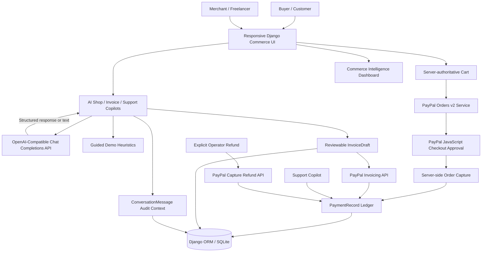
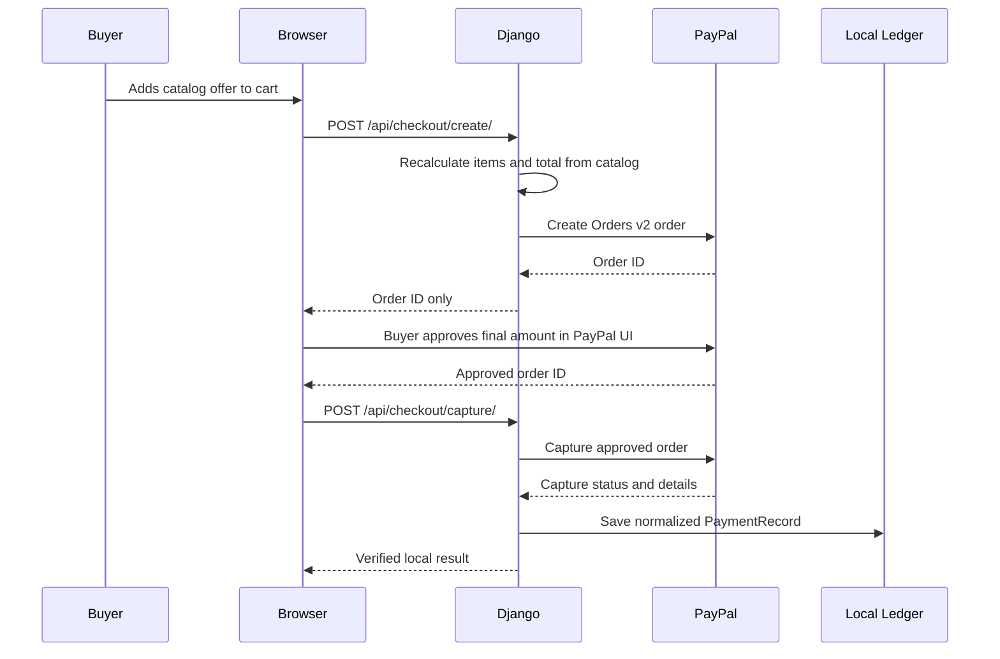
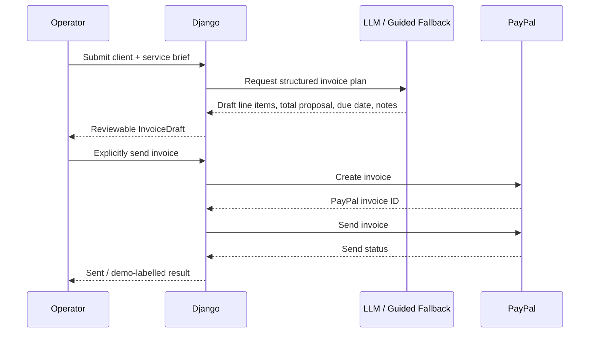

<div align="center">

# PAYPILOT AI
### AI-Powered Commerce Concierge, PayPal Checkout, Invoicing, Payment Support & Business Intelligence


</div>

> **Submission status:** This README documents **PayPilot AI**, an independent hackathon prototype. It is not an official PayPal product, partner integration, payment institution, financial adviser, or accounting/tax service. PayPal payment approval remains with the payer in the PayPal flow. AI outputs are advisory drafts and must be reviewed by a human operator.
>
> **Team action before submission:** Complete the submission details with the verified problem-statement ID, team, institution, repository and demonstration links. Do not claim PayPal endorsement, transaction volume, compliance, production readiness, or an integration status that has not been verified.

---

## Table of Contents

- [Submission Details](#submission-details)
- [Problem Statement](#problem-statement)
- [Our Solution](#our-solution)
- [Key Features](#key-features)
- [Why PayPal + AI Is Meaningful Here](#why-paypal--ai-is-meaningful-here)
- [System Architecture](#system-architecture)
- [Agent Workflow and Control Boundaries](#agent-workflow-and-control-boundaries)
- [PayPal Payment and Invoice Flows](#paypal-payment-and-invoice-flows)
- [Technology Stack](#technology-stack)
- [Getting Started](#getting-started)
- [Configuration](#configuration)
- [Using the Prototype](#using-the-prototype)
- [PayPal Sandbox and Live Setup](#paypal-sandbox-and-live-setup)
- [Security and Responsible AI](#security-and-responsible-ai)
- [Testing and Evaluation](#testing-and-evaluation)
- [Suggested Jury Demonstration](#suggested-jury-demonstration)
- [Project Structure](#project-structure)
- [Current Scope and Limitations](#current-scope-and-limitations)
- [Roadmap](#roadmap)
- [Troubleshooting](#troubleshooting)
- [Team and License](#team-and-license)

## Submission Details

| Item | Details |
|---|---|
| Project name | **PayPilot AI** |
| One-line pitch | Human-controlled agentic commerce for discovery, checkout, invoicing, support, and payment intelligence |
| Hackathon / edition | **To be filled by the team** |
| Problem statement ID | **To be filled from the official allocation** |
| Team name / ID | **To be filled by the team** |
| Participating institution | **To be filled by the team** |
| Team leader | **To be filled by the team** |
| Mentor(s) | **To be filled by the team** |
| Repository URL | **To be added** |
| Demo video / presentation | **To be added** |
| Prototype version | **1.0** |
| Payment environment for demonstration | Guided local demo by default; PayPal Sandbox when credentials are configured |

## Problem Statement

Independent professionals and small commerce teams often operate fragmented customer journeys:

- Customers need help choosing the right offer before they are ready to buy.
- Freelancers repeatedly translate informal work briefs into invoices.
- Support teams need verified payment context before answering payment questions.
- Operators need an understandable view of sales, invoice exposure, and recent payment activity.

Traditional chatbots can suggest products but do not safely connect a recommendation to a real payment workflow. Payment dashboards record transactions but generally do not help a merchant turn customer intent into the next useful action.

**The challenge:** combine AI assistance with real payment infrastructure without letting a model autonomously charge a buyer, misrepresent a payment state, fabricate financial facts, or execute a refund without human approval.

## Our Solution

PayPilot AI is a Django-based commerce workspace that combines a catalog-aware AI copilot with **PayPal Checkout**, **PayPal Invoicing**, payment-aware support, and operations intelligence.

Rather than treating the AI as an autonomous wallet, PayPilot deliberately separates what the AI can suggest from what the payment system and human operator can authorize:

- **AI understands intent** — it recommends catalog items, drafts invoice plans, summarizes commerce signals, and proposes cautious support responses.
- **Django controls server-side money data** — catalog prices are looked up on the server and browser clients never receive the PayPal secret.
- **PayPal confirms payment** — the buyer sees and approves the final amount in PayPal Checkout.
- **Humans decide consequential actions** — invoice sending and refunds remain explicit operator actions.

### Design Differentiators

1. **Recommendation-to-payment continuity:** A shopper can move from a natural-language need to a catalog recommendation and a PayPal Checkout approval flow in one experience.
2. **Server-authoritative totals:** The browser sends product SKU and quantity; Django calculates the amount from the local catalog before creating a PayPal order.
3. **Reviewable AI invoices:** The model produces an editable invoice plan, not an automatic invoice or charge.
4. **Evidence-aware payment support:** AI sees selected local payment status and amount, then distinguishes verified facts from suggested next steps.
5. **Human-in-the-loop money movement:** The AI never invokes the refund endpoint. A human must explicitly confirm a refund action.
6. **Honest degraded mode:** When no LLM key or PayPal credentials are configured, the app uses clearly labelled guided-demo behavior rather than pretending a live service completed an action.

## Key Features

### Conversational AI Shop

- Display a curated digital-offer catalog stored in Django.
- Accept buyer goals, budget, or timeline in natural language.
- Send catalog, cart, and shopper context to an OpenAI-compatible model when configured.
- Return catalog-grounded recommendations and optional add-to-cart suggestions.
- Provide a deterministic guided fallback so the prototype remains usable without an LLM key.
- Keep the final purchase decision outside the AI response and inside the PayPal approval flow.

### PayPal Checkout

- Create a server-authoritative PayPal Orders v2 request from local product prices.
- Load the PayPal JavaScript button only when a public client ID is configured.
- Capture an approved order server-side and normalize it into a local `PaymentRecord`.
- Store order ID, capture ID, status, amount, payer information when returned, and raw payload for troubleshooting.
- Provide a visibly marked local demo capture path when credentials are absent.

### AI Invoice Studio + PayPal Invoicing

- Turn a plain-language service brief into reviewable invoice line items, totals, tax rate, and due date.
- Require the operator to supply a client name and valid email before a draft is stored.
- Preserve the AI plan, notes, local draft, and PayPal invoice identifiers separately.
- Create and send invoices through the PayPal Invoicing API after operator review.
- Keep demo invoice sends visibly marked as demo actions when no PayPal credentials are present.

### Payment-Aware Support Desk

- Let an operator select a normalized local payment record as verified context.
- Draft a cautious support answer that distinguishes facts from recommendations.
- Avoid credential requests, unsupported payment claims, or autonomous action.
- Recommend a refund review only when appropriate; the actual refund requires explicit operator confirmation.
- Record basic conversation history per session for auditability within the prototype.

### Commerce Intelligence

- Summarize completed local PayPal capture records and open invoice value.
- Generate an operations brief through the configured LLM or a disclosed guided fallback.
- Show a transparent seven-day baseline forecast based on completed capture history.
- Display normalized transaction status, amount, source, and demo markers.
- Present forecasts as directional planning aids, not financial advice or guaranteed revenue predictions.

### Guided Demonstration Data

- Seed six example digital offers.
- Seed clearly labelled demo payment records in completed, pending, and refunded states.
- Seed one reviewable demo invoice.
- Keep all demo records isolated from real PayPal API calls.

## Why PayPal + AI Is Meaningful Here

| Capability | AI responsibility | PayPal responsibility | Human checkpoint |
|---|---|---|---|
| AI Shop | Interpret intent, compare catalog items, recommend SKUs | Display payer approval and process Checkout payment | Buyer approves final amount in PayPal |
| Checkout ledger | Explain shopper intent; never declare payment complete | Create/capture order and return payment status | Merchant reviews local payment record before fulfilment |
| Invoice Studio | Convert an informal brief into a structured invoice draft | Create and send an invoice | Operator reviews recipient, amount, tax, due date, then sends |
| Support Desk | Draft factual, cautious resolution language | Provides the underlying order/capture context when integrated | Operator decides what to promise or escalate |
| Refund workflow | May recommend human review only | Processes the requested capture refund | Operator must explicitly type `REFUND` before submission |
| Intelligence | Create a narrative brief and transparent planning baseline | Supplies the capture records represented in the ledger | Operator interprets insights and acts outside the model |

The combination is not “AI takes payments.” It is **AI-assisted commerce with PayPal as the payment authority and humans as decision-makers**.

## System Architecture



If the repository viewer does not render Mermaid, the implementation follows this sequence:

```text
Customer intent → AI catalog recommendation → Server-priced cart
                → PayPal payer approval → Server-side capture → Local payment ledger

Service brief → AI invoice plan → Operator review → PayPal invoice create/send

Payment question + selected verified record → AI support draft → Human decision
```

## Agent Workflow and Control Boundaries

PayPilot uses bounded Django services and optionally an LLM endpoint. It does **not** implement an unrestricted autonomous purchasing or finance agent.

| Component | Responsibility | Control boundary |
|---|---|---|
| Shopping copilot | Recommend real catalog products based on a prompt, budget, and cart | May not create a charge or claim payment completion |
| Cart service | Resolve SKU, inventory, and server-side product price | Browser does not provide a trusted price or final total |
| Checkout service | Create/capture a PayPal order | Buyer approval occurs through PayPal, not through the LLM |
| Invoice copilot | Draft description, line items, tax rate, due-date proposal, and notes | Operator supplies recipient and reviews every draft before send |
| Invoicing service | Create and send a reviewed invoice | Uses the PayPal API only after an explicit UI action |
| Support copilot | Explain selected local payment facts and suggest cautious next steps | Does not issue a refund, disclose credentials, or promise unverified outcomes |
| Refund service | Submit an explicitly approved capture refund | Requires `operator_confirmation: "REFUND"`; AI never calls it |
| Analyst | Summarize aggregate operational data and calculate a transparent baseline | No financial advice, investment guidance, or revenue guarantee |

### Prompt and Failure Handling

- The LLM system prompts tell the model to treat customer text as untrusted input.
- Catalog recommendations are filtered to valid local SKUs before being returned.
- Invoice fallback does not invent a price if the brief contains no amount; it uses `0.00` and asks for review context.
- Support prompts are constrained to selected verified payment data.
- LLM errors fall back to a disclosed guided-demo response rather than blocking a cart or invoice workflow.
- PayPal network/API errors are returned to the operator as safe error messages; the UI does not silently mark a transaction successful.

## PayPal Payment and Invoice Flows

### 1. Checkout Flow



### 2. Invoicing Flow



### PayPal API Surface in This Prototype

| Workflow | Endpoint used by Django service |
|---|---|
| OAuth token | `POST /v1/oauth2/token` |
| Checkout order creation | `POST /v2/checkout/orders` |
| Checkout capture | `POST /v2/checkout/orders/{id}/capture` |
| Invoice creation | `POST /v2/invoicing/invoices` |
| Invoice send | `POST /v2/invoicing/invoices/{id}/send` |
| Capture refund | `POST /v2/payments/captures/{capture_id}/refund` |

The project selects PayPal Sandbox or Live endpoints from `PAYPAL_MODE`. The client secret remains server-side and is never included in browser code.

## Technology Stack

| Layer | Technology |
|---|---|
| Backend | Python 3.11+, Django 5.2, Django ORM |
| Database | SQLite for prototype workflow data; designed to be replaced by PostgreSQL in deployment |
| Frontend | Django templates, semantic HTML, responsive CSS, vanilla JavaScript |
| Payments | PayPal REST APIs and PayPal JavaScript SDK |
| AI | OpenAI-compatible Chat Completions API through `requests` |
| Demo intelligence | Deterministic catalog, invoice, support, and forecasting fallbacks |
| HTTP client | `requests` |
| Environment loading | `python-dotenv` |
| Tests | Django `TestCase` and Django test client |

Runtime dependencies are listed in [`requirements.txt`](requirements.txt).

## Getting Started

### Prerequisites

- **Python 3.11+** recommended.
- pip and virtual-environment support.
- A modern browser.
- Optional: a PayPal developer account and Sandbox buyer/seller accounts.
- Optional: an OpenAI-compatible provider key for live LLM responses.

The project runs end-to-end without a PayPal or LLM key in clearly labelled guided-demo mode.

## Configuration

Copy the supplied template before configuring external services:

```bash
cp .env.example .env
```

The Django settings load `.env` through `python-dotenv`. Restart Django after changing environment values.

| Variable | Default / example | Purpose |
|---|---|---|
| `DJANGO_SECRET_KEY` | Development fallback | Replace with a strong random secret outside local development |
| `DJANGO_DEBUG` | `True` | Enable only for controlled development |
| `DJANGO_ALLOWED_HOSTS` | `localhost,127.0.0.1,.e2b.app,testserver` | Comma-separated allowed hosts |
| `PAYPAL_MODE` | `sandbox` | Use `sandbox` for testing or `live` only after controlled validation |
| `PAYPAL_CLIENT_ID` | Empty | Public client ID used to load PayPal Checkout button |
| `PAYPAL_CLIENT_SECRET` | Empty | Server-only OAuth/API credential; never expose it in a template or browser bundle |
| `PAYPAL_CURRENCY` | `USD` | Currency used for Checkout and invoices; demo catalog prices are authored in USD |
| `PAYPAL_BUSINESS_NAME` | `Northstar Studio` | Merchant brand name used in PayPal payloads |
| `PAYPAL_BUSINESS_EMAIL` | `merchant@example.com` | Merchant email passed to the Invoicing payload |
| `OPENAI_API_KEY` | Empty | Enables real OpenAI-compatible LLM calls |
| `OPENAI_MODEL` | `gpt-4o-mini` | Chat model identifier sent to the configured provider |
| `OPENAI_BASE_URL` | `https://api.openai.com/v1` | OpenAI-compatible API root, without a trailing slash |

### Configuration Safety

- Never commit `.env`, a client secret, or an LLM provider key.
- Never send credentials through chat, screenshots, issue trackers, or browser-side code.
- Keep `PAYPAL_MODE=sandbox` while developing.
- Use a verified business email and appropriate PayPal account capabilities before attempting Live invoicing.

## Using the Prototype

### AI Shop

1. Open **AI Shop**.
2. Ask the copilot a goal, budget, or timeline, for example: `I need a practical launch plan under $100.`
3. Review the catalog recommendations.
4. Add an offer to the cart.
5. In guided demo mode, select **Try PayPal flow** to create a clearly labelled local demo capture.
6. With Sandbox configured, approve the displayed final amount with a Sandbox buyer account.

### Invoice Studio

1. Open **Invoice Studio**.
2. Enter a client name and valid client email.
3. Describe the completed work, amount, and due date, for example:

   ```text
   Invoice $2,400 for a brand identity sprint and launch messaging. Due in 14 days.
   ```

4. Generate the draft.
5. Review client, email, line items, amount, tax, due date, and notes.
6. Select **Send for payment** only when the draft is correct.

### Support Desk

1. Select a payment record when one is available.
2. Enter the customer question or internal issue summary.
3. Review the AI answer as a draft, not a binding customer commitment.
4. If a refund review appears appropriate, use the separate operator flow.
5. Type `REFUND` only after independently confirming the amount, delivery status, and refund policy.

### Intelligence

1. Open **Intelligence**.
2. Inspect the normalized local payment ledger.
3. Select **Refresh AI brief**.
4. Treat the resulting forecast as a transparent short-horizon baseline, not a financial prediction.

## PayPal Sandbox and Live Setup

### Sandbox First

Create a PayPal developer application and Sandbox seller/buyer accounts. Set the environment values:

```dotenv
PAYPAL_MODE=sandbox
PAYPAL_CLIENT_ID=your_sandbox_client_id
PAYPAL_CLIENT_SECRET=your_sandbox_client_secret
PAYPAL_BUSINESS_NAME=Your Sandbox Store
PAYPAL_BUSINESS_EMAIL=your-sandbox-merchant-email@example.com
```

Restart Django, add a catalog item, and approve Checkout with the **Sandbox buyer**, never a real buyer account.

### Live Mode

After successful Sandbox testing, obtain a separate Live client ID and secret from PayPal Developer Dashboard and set:

```dotenv
PAYPAL_MODE=live
PAYPAL_CLIENT_ID=your_live_client_id
PAYPAL_CLIENT_SECRET=your_live_client_secret
```

Before processing real payments, deploy to an HTTPS domain and complete the production controls listed below. Do not use temporary previews, debug configuration, public demo data, or SQLite alone as a production payment environment.

### Important Production Gap

The current prototype records the synchronous Checkout capture response but does **not** yet include a verified PayPal webhook endpoint for asynchronous reconciliation of captures, refunds, disputes, or invoice-payment lifecycle events. Add verified webhooks and idempotency/reconciliation controls before production use.

## Security and Responsible AI

### Implemented Safeguards

- Django CSRF middleware and POST-only mutation endpoints.
- Server-side cart resolution, price calculation, and PayPal order creation.
- PayPal client secret excluded from browser configuration.
- Session-bound pending orders before a capture request is accepted.
- Explicit human `REFUND` confirmation requirement.
- Local payment and invoice records distinguish `is_demo` data from live API data.
- LLM prompts instruct the model not to request credentials, invent financial/legal terms, claim unsupported payment states, or autonomously move money.
- LLM output is checked for valid catalog SKU values before recommendations are returned.
- Safe error responses for PayPal API/network failures.
- Basic local conversation trace for shopping and support interactions.

### Operating Principles

> AI can recommend an item. It cannot make the buyer approve it.  
> AI can draft an invoice. It cannot send it without an operator action.  
> AI can suggest a refund review. It cannot submit a refund.  
> A local ledger row is not a substitute for reconciliation, accounting, or a PayPal source-of-truth review.

### Before Real Deployment

Add authenticated merchant accounts and role-based permissions; verified PayPal webhooks; PayPal request idempotency; durable PostgreSQL storage; encrypted secrets; HTTPS; strict CSP/frame protections; rate limits; logs/monitoring; error reporting; backups; accounting reconciliation; refund policy enforcement; privacy/retention policies; tax/legal review; accessibility review; and independent security testing.

This prototype has no merchant login or staff authorization layer yet. Do not expose its invoice, refund, support, or analytics routes to the public internet with Live credentials.

## Testing and Evaluation

Run the standard Django checks and workflow tests:

```bash
python manage.py check
python manage.py test commerce -v 2
```

At the current development checkpoint, **4 automated tests** cover:

- Rendering of the five primary pages.
- Server-authoritative demo checkout creation and capture ledger recording.
- AI invoice fallback drafting and explicit refund confirmation gate.
- Catalog-grounded guided AI shop responses.

### Recommended Evaluation

| Area | Suggested measure |
|---|---|
| Recommendation quality | Human relevance rating, catalog-SKU validity, add-to-cart conversion in a consented test cohort |
| Invoice draft quality | Correct total/date/line-item extraction against reviewed briefs |
| Support quality | Factual alignment with selected payment record and reviewer edits required |
| Payment integrity | Server-vs-browser total comparison, duplicate capture/idempotency handling, Sandbox reconciliation |
| AI safety | Rate of unsupported payment claims, credential requests, or unauthorized action attempts |
| Usability | Time from shopper need to Checkout, time from brief to reviewed invoice, mobile task completion |
| Reliability | API/LLM error rate, fallback activation rate, and complete audit context availability |

No payment conversion rate, revenue gain, fraud reduction, accuracy percentage, or time-saving percentage is claimed without a separately designed evaluation.

## Suggested Jury Demonstration

Use only synthetic data and PayPal Sandbox accounts. Do not show secrets, personal customer data, or real payment records.

| Step | Demonstration | Expected observation |
|---|---|---|
| 1 | Open Overview | Unified commerce dashboard with clearly labelled demo data |
| 2 | Ask AI Shop for a goal and budget | Catalog-grounded recommendations, not arbitrary products |
| 3 | Add an item and start demo Checkout | Server-authoritative cart total and explicit PayPal boundary |
| 4 | Switch to Sandbox configuration | Real PayPal Sandbox button appears without exposing the secret |
| 5 | Approve with a Sandbox buyer | Captured order appears in the normalized local ledger |
| 6 | Generate an invoice from a freelancer brief | Reviewable line items, total, due date, and safety notes |
| 7 | Send a demo/Sandbox invoice | Operator-controlled invoice action and PayPal linkage |
| 8 | Ask Support Desk about a completed payment | Grounded support draft distinguishes status from recommendation |
| 9 | Demonstrate refund safeguard | Refund endpoint refuses action until human types `REFUND` |
| 10 | Refresh Intelligence | Transparent seven-day baseline and operations brief |
| 11 | Remove the LLM key | Guided-demo mode remains usable and visibly disclosed |

## Project Structure

```text
paypilot_ai/
├── manage.py
├── requirements.txt
├── .env.example
├── .gitignore
├── README.md
├── paypilot/
│   ├── settings.py               # Django, PayPal, LLM and static configuration
│   ├── urls.py
│   ├── wsgi.py
│   └── asgi.py
└── commerce/
    ├── models.py                 # Product, PaymentRecord, InvoiceDraft, ConversationMessage
    ├── views.py                  # Pages and server-authoritative API endpoints
    ├── urls.py
    ├── admin.py
    ├── tests.py
    ├── services/
    │   ├── paypal.py             # OAuth, Checkout, Invoicing and Refund REST client
    │   ├── ai.py                 # LLM boundary, guardrails and guided fallbacks
    │   └── demo.py               # Catalog and clearly labelled demo records
    ├── management/commands/
    │   └── seed_demo.py
    ├── migrations/
    │   └── 0001_initial.py
    ├── templates/commerce/       # Dashboard, shop, invoices, support and analytics UI
    └── static/commerce/
        ├── css/app.css
        └── js/
            ├── app.js
            ├── shop.js
            ├── invoices.js
            ├── support.js
            └── analytics.js
```

`db.sqlite3`, `.env`, `.venv`, and collected static files are local runtime artifacts and must not be committed with credentials or private transaction data.

## Current Scope and Limitations

| Area | Functional prototype | Not yet implemented / not claimed |
|---|---|---|
| Checkout | PayPal Orders creation/capture endpoints and Sandbox-ready browser button | Webhook-backed reconciliation, disputes, chargebacks, saved payment methods, subscriptions, shipping/tax engine |
| Invoicing | AI draft, PayPal invoice create/send pathway | Invoice payment webhooks, invoice editing after PayPal creation, payment reminders, tax/legal validation |
| AI | OpenAI-compatible chat boundary and disclosed local fallback | Fine-tuned commerce model, retrieval system, multilingual evaluation, guaranteed factual correctness |
| Support | Payment-context-aware response drafting and human refund gate | Customer authentication, ticketing connector, automated resolution, SLA routing |
| Intelligence | Aggregate summary and transparent seven-day baseline | Financial reporting, accounting integration, causal forecasting, certified analytics |
| Security | CSRF, server-side prices, local payload storage, explicit refund confirmation | Login/RBAC, rate limits, secret manager, webhook verification, immutable audit trail, encryption-at-rest |
| Data | SQLite prototype ledger and synthetic seed data | Production database, retention workflow, privacy tooling, multi-merchant isolation |
| Operations | Django development workflow | Queue workers, retries, observability, horizontal scaling, disaster recovery |

### Known Prototype Considerations

- PayPal Live credentials should not be used in the shared development preview.
- The guided fallback is deliberately useful but is not a substitute for a live LLM.
- A completed capture record is saved from the capture API response; production reconciliation requires webhooks and source-of-truth review.
- The current catalog is synthetic and USD-oriented.
- Refunds in the demo path are local, clearly marked simulations.
- There is no user authentication around merchant-facing screens; protect routes before deployment.

## Roadmap

- Add verified PayPal webhooks for checkout captures, refunds, disputes, invoices, and invoice payments.
- Introduce PayPal request IDs/idempotency persistence and transaction reconciliation jobs.
- Add merchant authentication, staff roles, owner scoping, audit review, and dual approval for refunds.
- Migrate production storage to PostgreSQL and introduce encrypted secret management.
- Add real catalog management, inventory integration, taxes, currencies, shipping, and fulfilment handoffs.
- Add a retrieval layer over approved merchant policies, product documentation, and support knowledge.
- Add LLM evaluation sets for grounded recommendations, invoice extraction, and payment-support safety.
- Add background tasks, retries, dashboards, observability, and alerting.
- Add accessible localization and multilingual prompts after evaluation.
- Complete security, accounting, legal, privacy, and payment-compliance reviews before live rollout.

These are planned extensions, not existing prototype capabilities.

## Troubleshooting

| Symptom | First check |
|---|---|
| `ModuleNotFoundError: django` | Activate `.venv` and run `python -m pip install -r requirements.txt` |
| Database table error | Run `python manage.py migrate` |
| Empty catalog | Run `python manage.py seed_demo` |
| AI response says guided demo | Add `OPENAI_API_KEY`, `OPENAI_MODEL`, and `OPENAI_BASE_URL`, then restart Django |
| PayPal button does not appear | Confirm both PayPal client ID and secret are set, use the matching mode, restart Django, and check browser network access |
| PayPal OAuth rejects credentials | Confirm the client ID/secret belong to the selected `sandbox` or `live` environment; never paste the secret into an issue or chat |
| Checkout is rejected | Check PayPal account capability, item/currency configuration, Sandbox buyer account, and the server log's safe error message |
| Invoice creation fails | Confirm `PAYPAL_BUSINESS_EMAIL`, merchant account configuration, recipient email, and Invoicing capability |
| Environment change is ignored | Edit `.env` in the project root and restart the Django process |
| Layout appears stale | Hard-refresh the browser or clear cached static assets during development |

---

<div align="center">

**AI understands intent. PayPal confirms payment. People remain in control.**

*PayPilot AI turns commerce conversations into reviewable, accountable next steps.*

</div>
